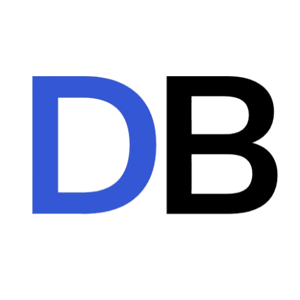

  

  <b>Software Development Intern</b> · Joinville, SC, Brazil 
  I build APIs in <b>Python</b> and interfaces in <b>React</b>.

  
  
  <!-- When you have a portfolio, uncomment this and replace the URL:
  
  -->

  <b>Open to opportunities</b> 
     Python Backend Dev · Full Stack · React Frontend 
     Remote · Hybrid · On-site

---

## 🧑‍💻 What I do
<b>Backend:</b> REST APIs with Python (FastAPI, Django, Flask), integrations and persistence with PostgreSQL. 
<b>Frontend:</b> React / Next.js with Tailwind, reusable components and accessibility (WCAG). 
<b>Automation & AI:</b> workflows with n8n, API integrations and generative AI in day-to-day work. 
<b>Delivery:</b> Docker and CI/CD for predictable deployments. 

## ⚙️ Tech Stack

  

## ⭐ Featured Projects

###  TransLive
A **real-time audio transcription and translation** system for conferences, talks and international presentations. It converts speech to text, translates it into the target language and displays **live captions** on screen, helping the audience follow speakers of other languages.

**Stack:** `[Python]` · `[Flask]`

**Links:** Private

---

###  DocBoard
A **clinical and financial monitoring dashboard** for Hemodynamics. It brings together goal management, physician productivity and patient safety indicators in a single panel.

**Stack:** `[Python]` · `[React]` · `[Supabase]` · `[FastAPI]` · `[Vite]`

**Links:** [Code](https://github.com/Enzo-Camelo/DocBoard)

 

##  GitHub Overview

  
  

## 💻 Activity

  <picture>
    <source media="(prefers-color-scheme: dark)" srcset="https://raw.githubusercontent.com/Enzo-Camelo/Enzo-Camelo/output/github-snake-dark.svg" />
    <source media="(prefers-color-scheme: light)" srcset="https://raw.githubusercontent.com/Enzo-Camelo/Enzo-Camelo/output/github-snake.svg" />
    
  </picture>

 

📫 Contact
Email: enzocamelo8d@gmail.com · LinkedIn: [enzo-camelo](https://www.linkedin.com/in/enzo-camelo)
